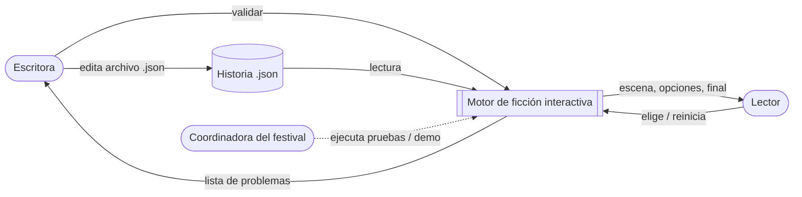
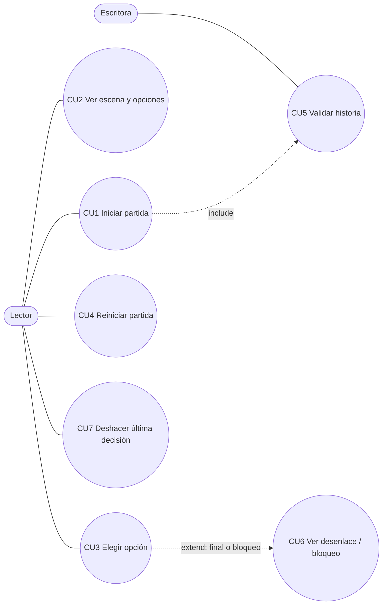
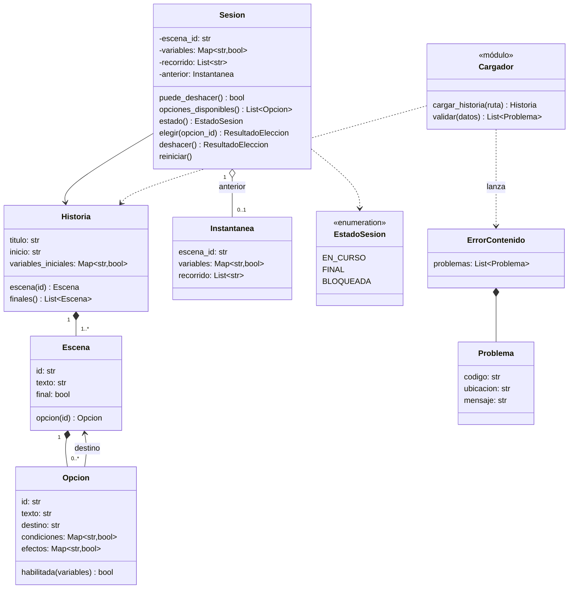
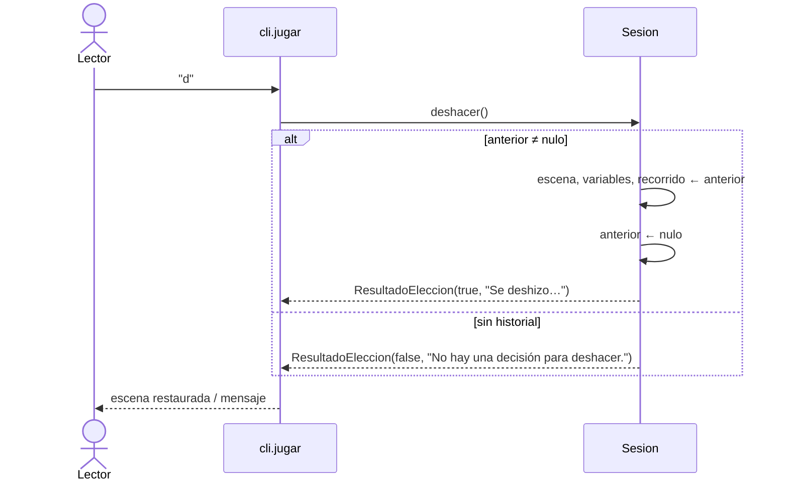
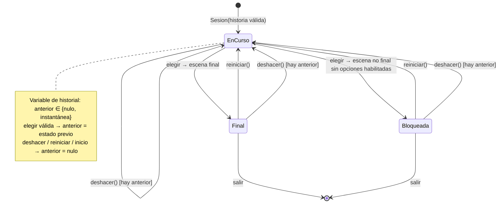
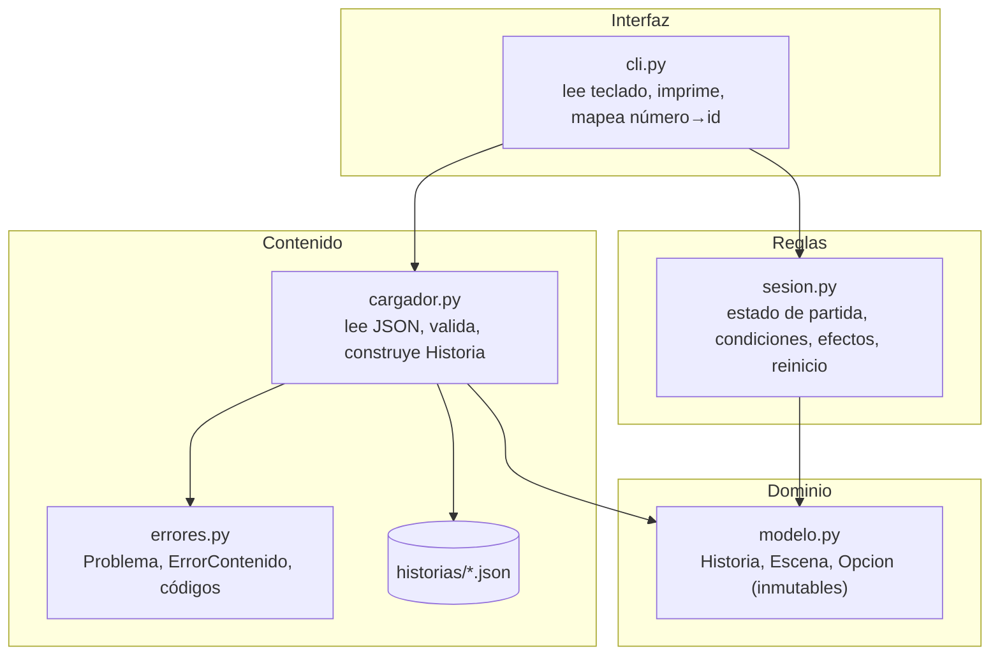
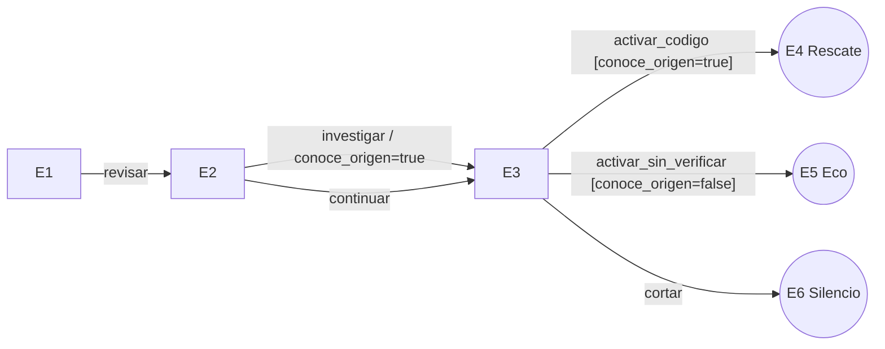

# Modelos y arquitectura

Diagramas en Mermaid (se renderizan en GitHub, VS Code o https://mermaid.live → exportar PNG/SVG para el anexo PDF). El mapa narrativo de la historia está al final y **no** sustituye a los modelos del software.

## 1. Contexto



## 2. Casos de uso



| CU | RF |
|---|---|
| CU1 | RF01, RF02, RF10 |
| CU2 | RF03, RF04 |
| CU3 | RF05, RF06, RF07 |
| CU4 | RF09 |
| CU5 | RF10, RF11, RF12 |
| CU6 | RF08, RF13 |
| CU7 (cambio) | RF14–RF19 |

## 3. Clases del dominio



## 4. Secuencia: elegir una opción

```mermaid
sequenceDiagram
  actor Lector
  participant CLI as cli.jugar
  participant S as Sesion
  participant O as Opcion
  Lector->>CLI: "1"
  CLI->>CLI: número → opcion_id (de opciones visibles)
  CLI->>S: elegir(opcion_id)
  S->>S: estado == EN_CURSO?
  S->>O: habilitada(variables) [por cada opción]
  alt opción habilitada encontrada
    S->>S: anterior ← instantánea(escena, variables, recorrido)
    S->>S: variables ← variables + efectos
    S->>S: escena ← destino; recorrido += destino
    S-->>CLI: ResultadoEleccion(aceptada=true)
  else inexistente / no habilitada
    S-->>CLI: ResultadoEleccion(aceptada=false, mensaje)
  end
  CLI->>S: escena, estado, opciones_disponibles()
  CLI-->>Lector: texto de escena y opciones / FINAL / bloqueo
```

### 4.1 Secuencia: deshacer (cambio hora 6)



## 5. Estados de una sesión



## 6. Componentes / capas



Regla de dependencias: las flechas solo van hacia abajo. `sesion.py` no sabe que existe JSON ni consola; `cargador.py` no sabe de reglas de juego; `modelo.py` no depende de nada.

**Separación contenido / reglas / interfaz:** el contenido cambia con frecuencia y lo editan no programadores; las reglas cambian rara vez; la interfaz podría pasar a web en el festival. Separarlos permite que cada cambio toque un solo módulo (RNF01) y que las reglas se prueben sin archivos ni teclado.

## 7. Decisiones de arquitectura (ADR)

### ADR-01 Validar todo antes de jugar y reportar todos los problemas
- **Contexto:** N06 y la coordinadora piden saber qué corregir sin que el programa se cierre.
- **Alternativas:** (a) validar de forma perezosa al entrar a cada escena; (b) detenerse en el primer error; (c) validar todo el archivo al cargar y acumular problemas.
- **Elección:** (c). `construir_historia` solo crea objetos si `validar` devuelve lista vacía.
- **Consecuencias:** + la escritora corrige todo en una pasada (RNF02); + `Sesion` puede asumir datos válidos y queda simple. − No detecta finales inalcanzables (fuera de alcance); el bloqueo se maneja en partida (RF13).

### ADR-02 Motor de reglas guiado por datos con estado inmutable de historia
- **Contexto:** RNF01 exige cambiar el relato sin tocar código; la guía prohíbe lógica específica por id.
- **Alternativas:** (a) clases/`if` por escena; (b) lenguaje de expresiones (eval); (c) mapas de igualdad booleanos evaluados genéricamente.
- **Elección:** (c). `Opcion.habilitada` = todas las igualdades se cumplen; efectos = actualización del mapa.
- **Consecuencias:** + 0 líneas de motor por historia; + sin `eval` (seguro). − Solo booleanos; ampliar a números u operadores requiere cambiar validador y `Opcion.habilitada` (cambio localizado en dos funciones).

### ADR-03 Deshacer mediante instantánea del estado anterior (cambio hora 6)
- **Contexto:** el cliente pide deshacer la última decisión revirtiendo todas sus consecuencias, un solo nivel, también desde un final.
- **Alternativas:** (a) calcular efectos inversos de la opción (requiere guardar valores previos de cada variable tocada; frágil si cambian los efectos); (b) patrón Command con pila de comandos (pensado para múltiples niveles y rehacer, que no se piden); (c) guardar una **instantánea inmutable** (escena, variables, recorrido) antes de cada elección válida.
- **Elección:** (c), con un único campo `anterior`.
- **Consecuencias:** + restauración exacta por construcción (RF14); + cambio confinado a `sesion.py` y a un comando en `cli.py`: **0 cambios** en `modelo.py`, `cargador.py`, `errores.py` ni en los JSON; + si se piden más niveles, `anterior` pasa a ser una pila. − Memoria de una copia de variables por partida (despreciable).

## 8. Decisión de diseño detallado (unidad 7)

`Sesion.elegir` recibe un **id**, no un número de menú, y siempre devuelve un `ResultadoEleccion` en vez de lanzar excepciones. Así (1) la consola es la única que conoce la numeración, y una futura interfaz web no cambia las reglas (bajo acoplamiento); (2) el estado se calcula en una copia y solo se asigna al final, de modo que una entrada inválida no puede dejarlo a medias (RF06, RNF03). Las vistas `variables` y `recorrido` devuelven copias para que nadie modifique el estado desde fuera. Con el cambio, la instantánea se toma **solo** en la rama de elección válida, de modo que una entrada inválida no puede reemplazar el historial (RF17).

## 9. Mapa narrativo (contenido, no modelo de software)


